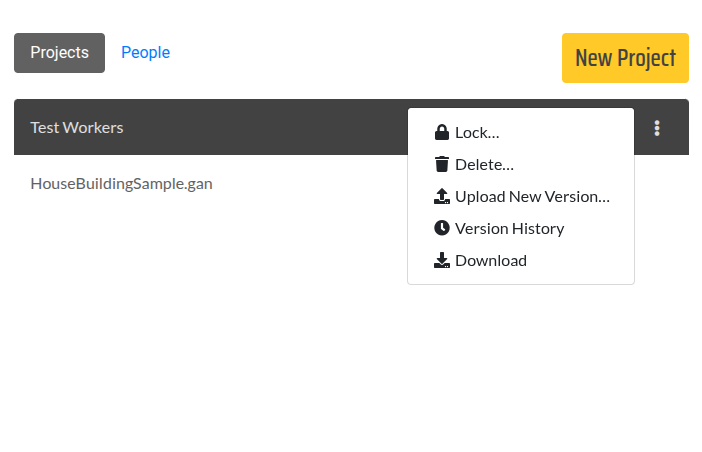

### Summary

* You can now download individual files from GP Cloud: either the latest version
  or any version from the file's history.
* You can upload a new version of a file from your computer.
* Both actions are billable.

### New Features

Until now, the GP Cloud web interface only let you create a new project file
and download a ZIP archive with the latest versions of all your files. You could not
download a single file or a specific version of it, and you could not upload a new version.
These actions were only available in GanttProject Desktop.

The November 2026 update adds them to the web interface. You'll find them in the file's
"⋮" menu. To download an older version, use the corresponding row in the file's history.

### ToS Updates

Downloading a file version and uploading a new version are billable activities.
If you were idle, performing either of them makes you an active user. Active users are
charged against the team budget monthly, as described in the
[Terms of Service](https://ganttproject.cloud/about/tos).

